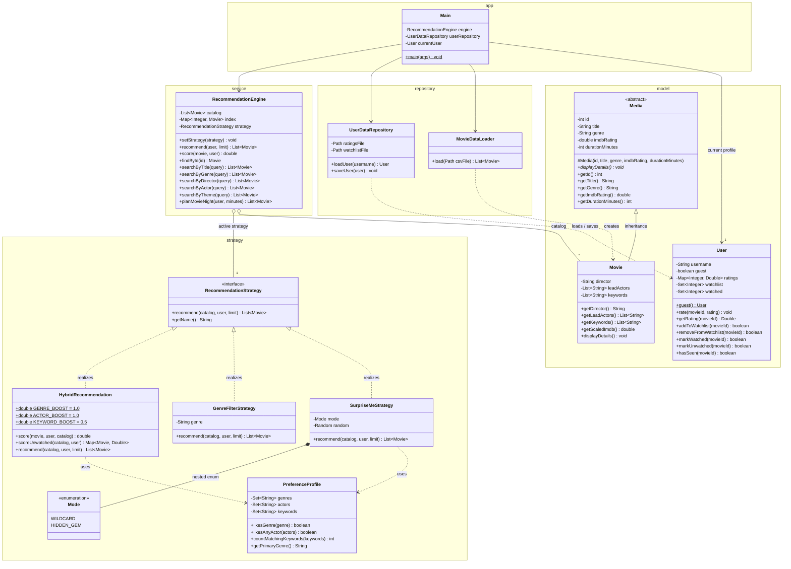

# CineMatch CLI — UML Class Diagram

## Relationships and OOP principles

| Principle | Where it appears |
|---|---|
| **Abstraction** | `Media` is an abstract class with the abstract method `displayDetails()`. `RecommendationStrategy` is an interface. |
| **Inheritance** | `Movie extends Media`. |
| **Polymorphism** | `Movie` overrides `displayDetails()`. `RecommendationEngine.setStrategy()` swaps Hybrid, Genre Filter and Surprise Me! strategies while the program runs, and `recommend()` calls whichever one is active. |
| **Encapsulation** | Every model field is `private`. The setters validate their input (for example, a rating must be 1.0–5.0 and a duration must be positive), and collection getters return unmodifiable views. |
| **Composition** | A `User` owns its ratings map, watchlist set and watched set, which are created and destroyed with it. |
| **Strategy pattern** | `RecommendationEngine` (the context) delegates to a `RecommendationStrategy`. |
